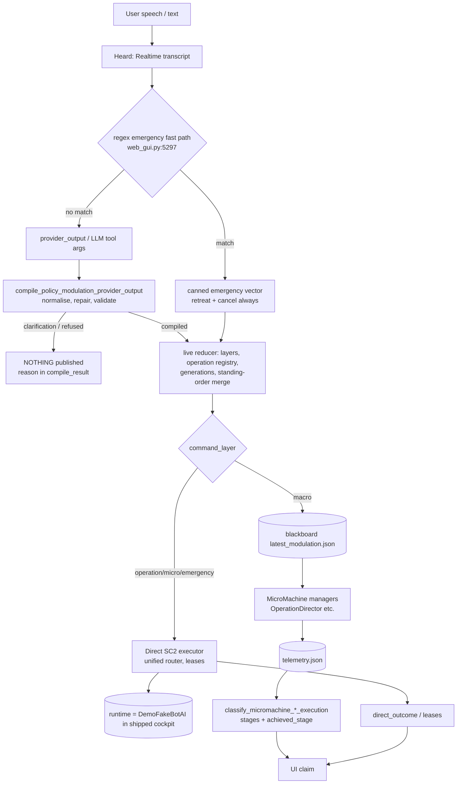

# Intent-fidelity audit: utterance -> DSL -> reducer -> executor -> evidence -> UI

Scope: Python side only, replayed offline. **StarCraft II is not available on this machine, so live
fidelity is unproven.** Nothing below is evidence that MicroMachine moved a unit. The only live evidence in
the repo is the recorded QA30 run (structured blackboard input, not natural language or voice).

Reproduce: `python -m scripts.fidelity.replay_chain --markdown out.md` (67 cases, 8 are recorded QA30
fixtures; 5 expected open violations remain: H-3 x1, H-4 x4) and `pytest tests/test_intent_fidelity.py`. A full per-case rendering is committed as
`docs/intent-fidelity-replay.generated.md`.

## 1. Chain



Key fact (verified by running it): the shipped cockpit starts `web_gui --dry-run`
(`local_cockpit.py:885`, `web_gui.py:13275-13308`). Only **macro** vectors reach the blackboard that
MicroMachine reads. Operation/micro/emergency are executed by the Direct path against the scripted
`DemoFakeBotAI` and return `status="direct_executed"`, `ok=true`, `runtime_attached=true`. qa30's 30/30 wrote
operation vectors straight to the blackboard (`qa30_scenario_command.py`, `publish_update`), a path the
product does not take for non-macro commands. So even recorded QA30 evidence does not describe what a spoken
"2 marines scout" does in the shipped app.

## 2. Status vocabularies: what each really guarantees

| Stage | Field / value | Really guarantees | Does NOT guarantee |
|---|---|---|---|
| Heard | Realtime transcript | audio was transcribed | anything about meaning |
| Compile | `compile_result.status` `compiled` / `clarification_required` / `refused` | DSL validated; refusal/clarification published nothing (replayed, 0 blackboard writes, 0 SC2 orders) | the compiled vector equals the ask (counts fixed by D1; ttl/army_group still repaired, see F-10) |
| Live status | `status` `published` | vector written to blackboard (`update` non-null) | MicroMachine read it |
| | `direct_executed` | Direct tool returned ok: every planned action applied by the executor | units moved; **in the shipped cockpit the executor is a fake bot** |
| | `direct_failed` | Direct refused or errored; reason in `command_queue.direct_outcome` (new) | |
| | `publish_failed` | write failed; reason in `command_queue.failure` (new) | |
| | `ok` | publication / direct acceptance only | effect |
| Consumption | `consumption_status` `consumed` | telemetry frame advanced and update id is in `active_modulation_ids` | the director assigned or ordered anything |
| | `pending_*` / `not_published` | | |
| Evidence stage (`stages[]`, `achieved_stage`) | `parsed` `reduced` `published` | always true once published (Python-side) | |
| | `consumed_by_manager` | OperationDirector reported the operation id and generation | units assigned |
| | `queued_or_assigned` | unit tags assigned (family-aware: every requested family covered) | requested count met (see `shortfall`) |
| | `order_issued` / `action_issued` | squad order submitted / SC2 action path accepted | movement |
| | `effect_observed` | movement >= 8/12 distance, engagement, or family effect rows | goal achieved |
| Operation `state` | first MISSING stage name, or a terminal word | | **not** "what happened": `state="consumed_by_manager"` means consumption was NOT proven in the legacy classifier; use `achieved_stage` |
| Terminal | `completed` | director completed AND assignment+order+action+effect all proven | |
| | `objective_observed_complete` (new state) | director closed the op because the objective was observed (e.g. defence point reached) | effect rows; shown as completed-without-full-evidence |
| | `cancelled` | director reported cancel | |
| | `blocked` (transient) | waiting for units/prereqs; reason in `blocker_reason` | |
| | `failed` / `expired` | hard block, routing mismatch, ownership conflict, lifetime exceeded | |
| Direct lease | `pending` `dispatched` `active` `completed` `expired` `cancelled` `failed` | ownership of concrete unit tags until terminal | game effect (completion needs adapter evidence: `target_reached`, ...) |
| Direct outcome (new) | `executed` `released` `partial` `conflict` `refused` `runtime_not_attached` `no_executable_action` `clarification_required` `planned` | `partial` carries `shortfalls[{requested, issued}]` | |

## 3. Defects found, fixed (red -> green) and open

All tests are in `tests/test_intent_fidelity.py`. Red = run before the fix, against unmodified code (15
failures for D1-D6 in the first run; D7-D12 each red individually, see section 7). Green = same tests after.

| ID | Defect | Fix (file) | Test |
|---|---|---|---|
| D1 | Composition `count` of `"2"`, `0`, `-1`, `None`, `True`, `2.5` was silently dropped and replaced by 1; `300` silently clamped to 200 | `policy_modulation_provider.py` `_requested_unit_count`: refuse with the count named | `UnitCountDowngradeTest` |
| D2 | "cancel operation X" on the Direct path was lowered into a NEW `attack_move` order and failed with `direct_control_conflict` against its own lease | `micromachine_live_session.py` `_direct_preflight`: release the operation's lease, issue no order; unknown operation refused with `no_active_direct_operation` | `DirectOperationCancelTest` |
| D3 | retarget/resize/reinforce edit collided with its own lease and was refused | same preflight: supersede own lease (`superseded_by:<update>`) then dispatch | `DirectOperationRetargetTest` |
| D4 | emergency retreat refused (`direct_control_conflict`) whenever any combat lease existed, i.e. exactly when it matters | preflight cancels combat-group leases (`emergency_preempted:<update>`), leaves worker/build leases | `EmergencyPreemptionTest` |
| D5 | Direct partial fulfilment ("10 marines", 6 exist) and refusal reasons lived only in `tool_results[].result.result.audit` | `command_queue.direct_outcome {status, reasons[], shortfalls[]}` | `DirectPartialFulfillmentTest` |
| D6 | QA30 scenarios 15/22/29: a director-COMPLETED operation (`objective_observed_complete`) classified `failed` | `micromachine_command_execution.py`: new state `objective_observed_complete`, not failed, not completed | `ObjectiveCompleteIsNotFailureTest` |
| D7 | requested N, assigned fewer: no field said so | `shortfall {requested, assigned, missing, allow_partial, reason}` on operation reports | `AssignedShortfallIsSurfacedTest` |
| D8 | QA30 scenarios 16/27: `WAITING_FOR_UNITS` + `squad_order=idle` reported as `routing mismatch` failure | idle before assignment is waiting; `composition_assignment_pending` is transient | `WaitingOperationIsNotARoutingFailureTest` |
| D9 | `publish_failed` carried no cause | `command_queue.failure {stage, reason}` | `PublishFailureReasonTest` |
| D10 | legacy `state` names the first missing stage (`consumed_by_manager` while consumption is unproven) | `achieved_stage` (last stage with all earlier proven) on every report | `AchievedStageTest` |
| D11 | `ttl_seconds` 5000 -> 900 and emergency 600 -> 60 silently | warning `ttl_seconds clamped: requested Xs, applied Ys` from the compiler | `SilentDurationClampTest` |
| D12 | compiler default `army_group="regroup"` is not a valid group: every un-grouped "retreat/regroup these units" was REFUSED | default `main` | `RegroupDefaultsAreValidTest` |

| D13 (H-1) | Concurrent operations over one unit type pinned the SAME first-N units ("2 scout, 4 attack" ordered marines 13,14 twice; one lease owned 4 units but 6 orders were issued) | new `direct_binding.bind_plan_actions` binds a plan carrying already-reserved tags; `bind_direct_action(exclude_tags=)` skips them; call sites `sc2_executor._bind_direct_plan`, `live_pipeline._bind_session_direct_plan`, `unified_command_router` (MCP boundary re-binds, never trusts pinned tags). Short supply: the later operation gets what is left and `direct_outcome.shortfalls` says "requested 4, issued 3" | `DisjointOperationTagsTest` (4) |
| D14 | an operation-keyed "마린 1기" ordered the WHOLE squad (count 1 was read as "default all") | operation-keyed actions honour their exact count; count 0 still means whole group (emergency) | `ExplicitCountTest` |
| D15 (H-6) | Viking/Medivac/Tank/Banshee/Thor orders were executed by Marines and reported `direct_executed` (`python_sc2_adapter.py:240` knows only SCV/Marine/Hellion) | `_select_group` selects the named Terran FAMILY in any form (sieged tank, assault viking...) or nothing; nothing -> refused `no_matching_units`, zero SC2 orders | `UnitClassSelectionTest` (3) |
| D16 (H-2) | regex fast path "공격 취소" also forced a retreat home | `web_gui._micromachine_emergency_safety_output`: `force_retreat` only when the utterance contains a retreat word (after negation stripping); cancel-only gets `cancelled_by_user`, `regroup_bias 0`; "공격 취소하고 후퇴" retreats | `EmergencyFastPathScopeTest` (4) |
| D17 (H-8) | `x`/`coordinates`/`position`/`map_point`/`location_xy`... were dropped with a warning and the command published with a DIFFERENT target | `policy_modulation_provider._refuse_coordinate_key`: refuse the whole command, reason names the key; unrelated unknown keys still only warn | `RawCoordinateRefusalTest` (2, 18 subtests) |

Existing suites touched by the changed files: see section 7.

### Open items: handoff (not in my files, or no safe fix)

Fixed since the first report and removed from this table: H-1 -> D13/D14, H-2 -> D16, H-6 -> D15, H-8 -> D17. H-3/H-9 were evaluated and left documented: both change when a standing order stops being applied, which is a product decision (does "후퇴" end "계속 생산"?), and the safe fix needs telemetry-aware pruning in the reducer, not a one-line change.

| ID | Where | Problem | Surfaces as |
|---|---|---|---|
| H-3 | `micromachine_live_session.py:2578` area (`_updated_live_layer_state`, emergency returns `{emergency: entry}`) | An emergency overwrite deletes the standing macro order (production). Retreat should not stop marine production. Also `_active_live_command_layers`: the macro reappears only because of a later merge | `emergency-keeps-macro` |
| H-4 | `micromachine_live_session.py` reducer `_live_command_lifetime` | Reducer rewrites ttl (45 -> 60, 120/300/900) without a warning; compile-stage clamps (D11) are now reported, reducer ones are not | `no_silent_clamp` x4 |
| H-5 | `web_gui.py:13275-13308`, `local_cockpit.py:885` | Direct runtime is the scripted fake bot. Responses say `runtime_attached: true`. Main already assigned `direct_runtime.kind` to VoiceAgent | UI must render "simulated" |
| H-7 | `demo_sc2.py:155` | `DemoUnit` has no `stop`/`hold_position`, so the dry-run bot refuses every emergency stop (`insufficient_units`). The tests add the two verbs locally | emergency refused in the shipped cockpit |
| H-9 | `micromachine_live_session.py` `_prune_live_layer_state` | A published macro order carries `expires_at_frame` (19900) yet is merged into a command issued at frame 40000. Expired standing orders are not pruned unless telemetry says so; with no telemetry they come back. Pinned in `macro-default-ttl-expiry` | stale production resurrected |
| H-10 | `web_gui.py:3714-3830` `_micromachine_intervention_summary` | Consumes legacy `state`; UI must switch to `achieved_stage` / `shortfall` / `direct_outcome` (section 5) | overclaim risk |
| H-11 | `transfer_*` edits need `before_composition` (`policy_modulation.py`) | The Realtime tool schema must produce `unit_selection` AND `before_composition` for "move 1 marine from scout to attack" or the command is refused (surfaced, not silent) | refusal |

## 4. Invariants and results (replay of 67 cases, projection and production chains)

| Invariant | Result |
|---|---|
| no silent unit-count downgrade | PASS after D1 (and shortfall visible, D7) |
| same operation_id upserts, new id parallel, generation +1, cancelled op stops counting | PASS (`same-id-retarget`, `reinforce-count`, `different-id-parallel`, `cancel-one-keep-other`, `restart-after-cancel`) |
| one unit one operation | PASS in Direct plans after D13 (disjoint tags, shortfall surfaced; `par-*`, `cancel-one-keep-other`, `transfer-between-ops` replays); telemetry-level overlap blocks both ops (`ownership-conflict-telemetry`) |
| emergency preempts only affected layers | Direct leases PASS (D4, worker lease kept); blackboard layers **FAIL (H-3)** |
| `published` never presented as `effect_observed` | PASS: published-only -> `ui.label=published`; every `effect_observed` claim required `assigned` and `ordered` (asserted in the unit test) |
| cancelled/superseded ops release ownership | PASS on Direct (D2/D3, `direct-cancel-releases`, TTL release); blackboard cancel is director-reported (`evidence-cancelled`) |
| clarification_required never publishes | PASS: 0 writes, 0 orders, 0 tools (`clarify-ambiguous`) |
| refusal reasons in a displayable field | PASS after D5/D9/D17: `compile_result.refusal_reason`, `clarification_prompt`, `command_queue.direct_outcome.reasons`, `command_queue.failure.reason` |
| macro persistence | persists across op/micro; replaced by newer macro; expired macro is resurrected (H-9) |

## 5. Overclaim risks in UI status text

| Risk | Where | Disposition |
|---|---|---|
| "실행됨/ordered" from `status=direct_executed` or `ok` | `LiveModulationStatus.DIRECT_EXECUTED`; true for the fake bot | Show **simulated** unless `direct_runtime.kind=="live"` (H-5). Never map to Ordered |
| "적용됨" from `consumption_status=consumed` | web_gui `intervention.applied` | Means "telemetry frame advanced and id active" only. Show "MicroMachine read it", not Assigned |
| rendering legacy `state` verbatim | `state=consumed_by_manager` with `consumed_by_manager.ok=false` | Use `achieved_stage`. Fixed in classifier (D10); UI adoption open (H-10) |
| "completed" for `objective_observed_complete` | | Treat as "Objective seen, effect not proven"; never green-with-checkmark of Effect |
| requested 4, assigned 1 shown as "assigned" | | `shortfall` (D7); blocked when partial not allowed |
| ignored coordinate | fixed (D17): refused with the key named | none |
| operation blocked by `producer_busy`/`training` while moving | recorded QA30 12/15/16: attack MOVING+effect but `blocker=training` | `state=blocked` with a reason, not failed |
| silent regroup refusal | D12 | fixed |

## 6. `ui_status_contract`

```json
{
  "ui_status_contract": {
    "version": 1,
    "rule": "A stage is shown only if its backend field proves it. Absent field = unknown, never done.",
    "heard":        {"from": "realtime transcript", "label": "Heard"},
    "understood":   {"from": "compile_result.status", "true_when": "== 'compiled'",
                     "warnings": "compile_result.warnings (clamps, ignored fields)",
                     "else": "compile_result.refusal_reason | compile_result.clarification_prompt"},
    "published":    {"from": "status", "true_when": "== 'published' and update != null"},
    "assigned":     {"from": "intervention.command_execution.operations[].achieved_stage | command_execution.achieved_stage",
                     "true_when": "rank(achieved_stage) >= rank('queued_or_assigned') for EVERY operation",
                     "shortfall": "operations[].shortfall -> show 'N of M'; blocked if allow_partial=false and assigned>0"},
    "ordered":      {"true_when": "rank(achieved_stage) >= rank('order_issued') for every operation",
                     "never_from": ["status", "ok", "consumption_status", "state"],
                     "direct": "direct_outcome.status in ('executed','released') AND direct_runtime.kind == 'live'"},
    "effect_observed": {"true_when": "rank(achieved_stage) >= rank('effect_observed') for every operation",
                        "never_when": "state == 'objective_observed_complete' or direct runtime is simulated"},
    "simulated":    {"true_when": "direct_runtime.kind == 'dry_run_fake_bot' and direct_outcome.status in ('executed','released')",
                     "label": "시뮬레이션(가짜 봇)"},
    "blocked":      {"true_when": "any of: compile.status != 'compiled'; operations[].failed|expired; state in ('blocked','cancelled'); direct_outcome.status not in ('executed','released','planned')",
                     "reason_fields_in_order": ["compile_result.refusal_reason", "compile_result.clarification_prompt",
                                                "command_queue.direct_outcome.reasons[]", "command_queue.failure.reason",
                                                "operations[].blocker_reason", "operations[].shortfall.reason"]},
    "stage_rank": ["parsed","reduced","published","consumed_by_manager","queued_or_assigned","order_issued","action_issued","effect_observed"],
    "unknown_state_policy": "unknown or missing => show muted 'unconfirmed'; never default to success",
    "forbidden_labels": {"Ordered": "when only published/consumed or simulated",
                         "Effect observed": "when assigned/ordered stage not proven, or objective_observed_complete only"}
  }
}
```

Backend guarantees for the contract: `achieved_stage`, `shortfall`, `command_queue.direct_outcome`,
`command_queue.failure` are new and covered by tests. `direct_runtime` is NOT implemented here (H-5).

## 7. Audit honesty: README "Current project state" claims, re-verified by running

| Claim | Result |
|---|---|
| "Python 314 passed/563 subtests" | **No such headline in the README or in any doc at HEAD.** A `314 passed, 1 skipped, 439 subtests passed` appears in git history (commit `0584f46`) as a focused-suite figure, not the full suite. The repository collects **3221 tests** (`pytest --collect-only`). A full run was started from a clean `git archive` copy and stopped at the 480 s cap at ~59 %: 1913 passed, 60 skipped, **9 failures not triaged** (the copy lacks `.local`/untracked inputs, so they may be environmental). **Full suite: not re-run to completion.** The 9 failures are ENVIRONMENTAL: all are `subprocess.CalledProcessError` from `git rev-parse HEAD` / `git -C /private/tmp/fid_base ...` (6 `test_battlefield_browser_gate` candidate-fixture tests, 2 `test_distribution_compliance` git-bound payload tests, 1 secret-scan test) because the copy was made with `git archive` and has no `.git`. The same 9 tests run in the real worktree: `42 passed, 1 skipped, 22 subtests` (that selection = the whole `BattlefieldBrowserGateContractTest` class + the 3 distribution tests). No code failure was seen in the 59 % that ran. |
| focused suites over every file I changed | `tests/test_intent_fidelity.py tests/test_python_sc2_adapter_contract.py tests/test_micromachine_live_session.py tests/test_micromachine_command_execution.py tests/test_policy_modulation_provider.py tests/test_unified_command_router.py tests/test_direct_command_architecture.py`: **439 passed, 1 skipped, 641 subtests**. `tests/test_web_gui.py -x`: **267 passed, 197 subtests**. Earlier run over 14 files (before D13-D17): 819 passed, 933 subtests |
| "Electron 6 tests" | `cd electron && npm install && npm test`: tests 6, pass 6, fail 0 (status doc `approved-direct-command-plan-status.md:38` says 5; it is stale) |
| "native contract tests" | `bash scripts/test_native_contracts.sh`: `native MicroMachine contract tests passed`, exit 0 |
| "recorded QA 30/30 (`final_audit.json`)" | `final_audit.json` says 30/30 passed. Re-running `python -m starcraft_commander.live_qa_audit` over the recording with `.local/qa-scenario-manifest-30.json`: **30/30 passed (exit 0)**. BUT the launcher log of that run (`qa30-live-r32-full-20260918-final.log`) ends `{"status":"incomplete","summary":{"blocked":2,"passed":28}}` with scenarios 19 and 28 NOT "independently passed"; their `scenario_audit.json` is `unverified` (written 03:00 / 03:54). `final_audit.json` (04:09) and `results.json` (30 passed) were produced afterwards by re-auditing the recorded telemetry, i.e. **30/30 is a post-hoc re-audit of recordings, 28/30 live-time**. Scope in the file: `recorded_SC2_runtime_evidence_only`, `natural_language_verified:false`, `voice_verified:false` |

## 8. What is NOT proven (no SC2 here)

Everything about actual unit behaviour. Not exercised: natural language or voice into the live game,
the C++ managers consuming a Direct-produced vector, the shipped cockpit with a real BotAI, parallel
ops over real unit tags (D13 disjoint tags is a Python-plan fix; it must be re-confirmed against live unit tags).

Live scenarios that must be run later, using the QA30 manifest names, **through `/api/realtime/intent`
and the real (non-dry-run) Direct runtime**, not blackboard writes:
`14-marine-scout`, `12-marine-natural-pressure`, `13-marine-main-attack`, `15-parallel-attack-defense`
(checks D13: disjoint tags), `16-defense-reinforcement`, `22-reassign-marines`, `23-reassign-tanks`,
`24-retarget` (D3), `21-cancel-attack` (D2), `20-retreat` (D4, D16), `25-long-defense`,
`27-prerequisite-wait` (D8), `29-heal-regroup` (D12), `10-tank-ramp-defense`/`11-tank-siege-hold`
(ability gating), `01-scv-production`..`06-marine-wave` (macro persistence after an emergency, H-3/H-9),
and `30-game-end`. Add: a Viking/Medivac order (D15: must be refused when none exist), a >N-count order (shortfall), and a Korean
"마린만 후퇴" scoped retreat.
